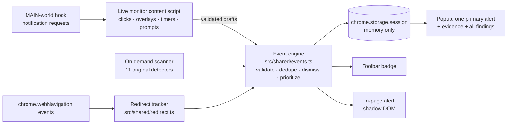

# TAIF — Trustworthy Adaptive Interfaces

TAIF is a Chrome Manifest V3 extension that watches what happens in your browser, explains suspicious behavior, and shows the evidence. Its main job is **contextual protection**: when an ad or a script takes you to another website, opens a pop-under tab, blocks the page with an overlay, or fakes a system warning, TAIF shows **one** clear alert with the real source and destination, how sure it is, and what you can do. It never clicks, blocks, submits, downloads, or grants permissions for you.

## Architecture



| Layer | Where |
|---|---|
| Observation | `background.ts` (webNavigation, tabs), `content/monitor.ts` (MutationObserver, IntersectionObserver, 1 s sampling of tracked timers/overlays only), `content/monitor-main.ts` (wraps `Notification.requestPermission` / `PushManager.subscribe`, never changes their result), `content/scan.ts` (user-triggered scan) |
| Detection & classification | `shared/redirect.ts` (feature A), `shared/live.ts` (features B, C; live scenario 2), `shared/detectors.ts` (scenarios 1–11) |
| Standard event, validation, dedupe, priority | `shared/events.ts`, type `TaifEvent` in `shared/types.ts` |
| Explanation & evidence UI | `ui/Popup.tsx` (primary alert + Evidence panel, feature E), in-page banner in `content/monitor.ts`, dashboard `ui/App.tsx` |

The backend (`backend/`, FastAPI + optional MongoDB) is **not used by the extension**. All detection runs locally and works with no backend and no network.

## Install and build

```bash
npm install
npm run build
```

In Chrome: `chrome://extensions` → Developer mode → **Load unpacked** → select `dist/`. After every rebuild, click **Reload** on the extension card.

## Permissions

| Permission | Why |
|---|---|
| `webNavigation` | Redirect and new-tab detection on every tab (Chrome shows this as "Read your browsing history"). URLs are kept only in memory-only session storage, with query strings removed from anything displayed. |
| `activeTab`, `scripting` | Scan the current page when you open the popup; apply reversible accessibility adaptations. |
| `storage` | Settings, scan history (max 30), session events. |
| **Optional** `http://*/*`, `https://*/*` | Granted only when you click **Enable live monitoring** in the popup. Enables click correlation, overlay/timer, fake-alert and notification-lure detection, and the in-page alert. Revoking it unregisters the scripts. |

Without the optional permission, redirects are still detected, but TAIF can't see clicks. Those alerts say so: "user interaction unknown", with verification status *inconclusive*.

## Detection overview

### Feature A — Redirect and new-tab detection (primary use case)
Correlates `onCreatedNavigationTarget` (opener → new tab), `onBeforeNavigate` (initial request), and `onCommitted` (transition type and `client_redirect` / `server_redirect` / `forward_back` qualifiers) with click signals from the live monitor. Sites are compared by approximate registrable domain, so `cdn.moviesda.ski` counts as the same site as `moviesda.ski`.

| Situation | Classification | Primary alert? |
|---|---|---|
| Same site | — | No |
| Typed URL, bookmark, reload, back/forward | user-driven | No |
| Click on a link to the destination | Expected external link (informational) | No |
| Click on a link, but ended on a different site | Link redirected elsewhere | Yes (medium) |
| Click on a non-link → new tab | Unexpected new tab (pop-under pattern) | Yes |
| New tab with no observed click | Unexpected new tab | Yes |
| Script/meta redirect, or no observed click | Unexpected redirect | Yes |
| ≥ 2 foreign sites in the chain | Redirect chain | Yes |
| Live monitoring off | "Cause unknown", low severity, inconclusive | Low priority |

Every redirect event carries separate claims: *Cross-site navigation* (verified, from browser events), *classification* (inferred or inconclusive), and *Destination is malicious* (always inconclusive). Server-side intermediate hops are not visible to webNavigation, so those chains are marked **incomplete** rather than filled in. Repeated commit events within 1.5 s are deduplicated. Client redirects within 15 s extend the same event instead of creating a new one.

### Feature B — Hidden timers and close buttons
Tracks up to 10 countdown elements and 5 large overlays (≥ 40 % of the viewport). Close controls are classified as visible, obscured (`elementFromPoint`), disabled, hidden, not found, or inconclusive (cross-origin iframe). Reports a reset only after the countdown was seen decreasing. It reports a blocked overlay after 8 s, and a delayed close only when the measured wait exceeds 15 s or the countdown reset. A short ad countdown followed by a close button is treated as normal.

### Feature C — Fake system warnings, downloads, notification lures
Text patterns alone ("virus detected") produce at most a **low** severity, *inconclusive* event. A **high** alert needs at least two supporting signals among: an executable download link (`.exe/.msi/.apk/.dmg/…`), urgent wording, or display in an overlay. A notification lure ("Click Allow to continue") plus an observed permission request gives medium severity with 0.85 confidence. A permission request on its own is informational. Nothing is clicked, downloaded, or granted.

### Feature D — Visible-area priority
Inserted subtrees are inspected incrementally: mutations are debounced 400 ms and capped at 400 elements per flush. There is no full-DOM rescan and no scroll listener. IntersectionObserver analyzes prompt candidates when they become visible and updates `in_viewport`, which raises priority. Priority considers severity, confidence, recency (< 2 min), the current page, the viewport, and acknowledgement. Navigation events get an immediacy bonus, so a redirect beats contrast or subscription findings (see the unit test).

### Feature E — Evidence panel
Each alert shows: scenario and ID, observed event, source/destination (query removed), time and repeat count, element, severity and confidence (separately), classification and status (Observed / Inferred / Verified / Inconclusive), per-claim status, redirect chain with incomplete reasons, evidence, alternative explanations, limitations, and recommended action. Emails, phone-like and key-like values are masked.

### Original eleven scenarios
Context-aware detectors live in `src/shared/detectors.ts`; the evidence they reason over is collected by `src/content/scan.ts`. With live monitoring on, every page is checked automatically about 2 s after it loads, and again after large content changes (at most once per 10 s). The popup shows **every** real problem as its own card. Informational notes go under "Details". With no problems the popup says "No problems found" and the badge stays empty.

| # | Scenario | What raises a problem (and what doesn't) |
|---|---|---|
| 1 | Dark-mode readability | Text below WCAG contrast against its **real** background (ancestors composited; text on images/gradients skipped; large text uses 3:1). One grouped finding; controls raise severity. A missing dark theme is never flagged. |
| 2 | Urgency | A countdown that **restarts between visits** (value remembered per page in `chrome.storage.local`) or resets live. Urgency wording near the timer is shown as context. A normal countdown is never flagged. |
| 3 | Admin access | Only an admin-style route with admin controls visible: low and *inconclusive*. Admin links elsewhere are informational. **Gap:** no authorized Playwright/OWASP ZAP harness. |
| 4 | Scarcity | Stock count that **went up**, or the same "only N left" on many visits over 6 h+. A single claim is informational; never declared false. |
| 5 | Verification | Only forms collecting email/password/phone/payment with `novalidate` or no required/format checks; *inconclusive*. Search boxes are never flagged. **Gap:** no Playwright form tests. |
| 6 | Performance | Load > 5 s, 5+ long tasks (PerformanceObserver), or 3+ failed resources. Wording is never about server capacity. **Gap:** no k6/Locust load test. |
| 7 | Sensitive info | Only secret-shaped values (AWS/Stripe/GitHub/Slack/Google keys, private keys, JWTs), masked. Emails are informational. |
| 8 | Motor accessibility | One grouped finding: unnamed controls, targets < 24 px, CSS that removes focus outlines, image links without text. On-demand **full axe-core audit** from the popup. Adaptations are reversible. |
| 9 | Cross-page conflicts | Only when the selected page is the **same product** (JSON-LD sku/gtin, or name similarity ≥ 0.8). Currencies are normalized; different currencies are informational. |
| 10 | Subscription terms | Only on pages with a subscribe/trial/checkout action, when renewal/trial/refund terms are smaller, fainter or far (> 600 px) from that button. Shows the sentence and why. |
| 11 | Visual emphasis | Competing choices shown together (accept vs reject, subscribe vs no thanks) where the decline option is muted in **at least two** ways: 3× smaller, faint, see-through or tiny text. |

## Alert actions and dismissal

- **Stay here** — acknowledges the alert and keeps you on the page.
- **Back to <site>** — if the ad opened a **new tab**, switches to the tab you were on and **closes the ad tab**. This also covers "tab-under" ads, where the site reopens in a new tab and the old tab is sent to the ad. If the ad replaced the page in the **same tab**, it loads the previous page again (URL held only in memory-only session storage).
- **Got it** (page-check cards) — hides that finding. It stays hidden after rescans for 30 minutes.
- A navigation first recorded as "no click observed" is reclassified if the click signal arrives late. The in-page banner waits 1.5 s and re-checks, so a normal link never flashes an alert.
- **Dismiss** — acknowledges the alert and suppresses the same source-site → destination-site pair for 30 minutes. A repeat is still recorded under All findings, marked "dismissed recently", but is not raised again.
- **View evidence** — expands the evidence panel.

## Enhance page, Review & trust, Popup protection (popup tabs)

### Enhance page — one-click Analyze & Enhance
- **Analyze & Enhance Page** (Quick Enhance) or **Analyze (Review First)**. The mode switch is under the button.
- **What it scans:** the active page and its open shadow roots, for 12 categories. The rules and their limits are listed under *Show settings → Show detection rules*:
  - primary / secondary / submit / login-sign-up-verify controls
  - OTP fields
  - CAPTCHA
  - form fields and labels
  - navigation
  - errors
  - warnings/disclosures
  - small text
  - small controls
- **What it measures:** real size, font size and contrast for each element.
- **How it changes the page:** only through an extension-owned `data-taif-enh` attribute and one extension `<style>`. Original inline styles, nodes, listeners and link targets are never changed.
- **Verification:** each change is re-measured afterwards. Status is one of Detected / Suggested / Applied / Verified / Skipped / Unsupported / Unable to verify.
- **Why did the interface change?:** lists every change with the measured before → after sizes, the rule, and the context signal. Each change has its own **Undo**.
  - **Exclude this session** keeps an element out of later analyses.
  - **Restore original page (undo everything)** removes all of TAIF's attributes, styles, tips, risk highlights and page zoom.
- **CAPTCHA:**
  - Known CAPTCHA frames are scaled with `transform`, so clicks stay aligned inside cross-origin frames: reCAPTCHA (including the image challenge that appears later), hCaptcha, Turnstile, Arkose, GeeTest, AWS WAF and Friendly Captcha.
  - Text/image CAPTCHAs and their instructions/inputs are enlarged with `zoom`/font size.
  - **Zoom whole page** (`chrome.tabs.setZoom`) works on every site, including CAPTCHAs TAIF cannot detect, and is undoable.
  - TAIF never solves or bypasses a CAPTCHA.
- **Context signals:**
  - **Screen size:** Compact/Spacious, automatic or manual override.
  - **Session:** first-time visit shows short tips; returning visits skip them. A reset button is provided.
  - **Simulated risk (test input):** outlines payment/deletion controls, shows a caution card, and holds only the *first* click. The second, real click goes through untouched; events are never re-dispatched. Turning it off removes everything.

### Review & trust
- **Reads only** visible review text, rating, date, a masked pseudonym and the "verified" label, plus JSON-LD/microdata aggregates.
- **Checks** (each with evidence, rule, affected count, significance, limits and observation confidence):
  - exact / near-duplicate text
  - 2-day bursts
  - count/average contradictions (missing data is reported as missing)
  - generic praise (weak)
  - review–product mismatch (weak)
  - structured reviews missing from the page
- **Result:** one of "No significant issues detected in the available evidence" / "Some review reliability concerns" / "Multiple suspicious review patterns" / "Insufficient evidence". It never says "safe" and gives no trust percentage. Client-side (React) rendering is never treated as a signal.
- **Independent sources:** only on click, sending **only the domain**.
  - **RDAP** (domain registration date)
  - **Tranco** (research popularity ranking, an estimate that does not measure purchases)

  If either is unreachable it is shown as *unavailable*. Purchasing activity always reads: *Independent purchasing activity could not be verified.*

### Popup protection
- **Ad tabs:** with *Close ad tabs* on (the default), a new tab that TAIF is confident an ad opened (a click on a non-link, or no click) is closed after a 1.2 s re-check. The opener tab is focused. The page then shows **"Protected by TAIF — an unwanted popup tab (…) was closed"** with **Reopen**. The notice appears only after Chrome confirms the tab was closed. Every action is listed in the Protection tab.
- **Overlays (opt-in):** overlays that block the page with no close button are hidden cosmetically, with Undo. Login, payment, consent and age dialogs are never hidden.
- **Return button:** when you press *Back to …* on an ad tab, TAIF switches to the tab already showing the original site and closes the ad tab. It loads the previous page in place only when no such tab exists.
- **Ad-popup domains:** a new tab that lands on a domain EasyList marks as an ad popup (`$popup`, 2,735 domains) is also closed, unless it was a link you clicked.

### Ad block tab — "Block Ads & Clean Page"
Three separately switchable layers, all running locally:

1. **Network filtering:** Chrome `declarativeNetRequest` static rulesets built from the real lists by `scripts/build-filters.mjs` (refresh them with `npm run filters:update`).

   | List | Default | Chrome rules | Domains covered | Notes |
   |---|---|---|---|---|
   | **EasyList** (ads) | on | 3,784 | 53,505 ad-server domains plus URL patterns | |
   | **uBlock filters** (ads, popunders; GPLv3) | on | 740 | plus 1,221 hiding rules | Its ~2,400 scriptlet rules can't run in this extension and are skipped |
   | **EasyPrivacy** (trackers) | off, toggle | 9,137 | 47,414 domains | |
   | All three | | 13,661 | | Below Chrome's guaranteed 30,000 static rules |

   - Unsupported syntax is **skipped and counted, never broadened**, about 900 rules in total: `$redirect`, `$csp`, regex filters, procedural cosmetic filters, `$popup`.
   - **Update filter lists now** downloads the current lists from easylist.to and validates them. It then installs them as dynamic rules; any failure keeps the current rules.
   - **Pause on this site** adds an `allowAllRequests` rule. **Pause protection everywhere** disables the rulesets.
2. **Cosmetic filtering:** 13,681 generic + ~11,300 site-specific hiding rules (EasyList + uBlock filters).
   - On every navigation the service worker injects them as **native stylesheets** (`chrome.scripting.insertCSS`, user origin): `filters/generic.css` plus a small per-site sheet.
   - Chrome matches them itself, so there's no per-element JavaScript, pages stay fast, and ads that load later are hidden automatically.
   - Selectors are grouped in forgiving `:is()` lists, so one unsupported selector never disables its group.
   - **Block Ads & Clean Page** injects a small helper that counts matches, fades visible ads out before the stylesheet takes over, hides known ad-server iframes and ad overlays, collapses empty wrappers, and verifies the result. Main content, forms and payment/login areas are kept visible and counted as skipped.
   - **Restore cosmetic changes on this page** removes the stylesheets and every TAIF attribute. Requests already blocked can't be un-blocked; reload after pausing.
3. **Popup protection:** the ad-tab closer above, plus promotional overlays that contain an identified ad.

**The animation** advances only when each real operation returns: apply rules → match patterns → hide (fade) → overlays → verify. There are no artificial delays, and all motion is disabled under `prefers-reduced-motion`.

**The results** use only verified numbers:
- requests blocked on this tab, from Chrome's `getMatchedRules` (last 5 minutes), or a live count via `onRuleMatchedDebug` (unpacked installs only)
- elements confirmed hidden (computed `display: none`)
- overlays, collapsed spaces, skipped elements, and rules this browser can't evaluate

"No advertisements were detected" is shown honestly when that's the case.

**Notices:** *"Protected by TAIF — N advertising requests blocked"* (network) and *"… N advertisement elements suppressed"* (cosmetic). Each appears at most once per page load, or once per 30 s for late ads, can be switched off, and is logged under **Recent protection events**.

**Always on:** site access is a required permission, so redirect monitoring, alerts, ad hiding and popup protection run on every page without any extra step. If an in-page alert can't be shown (page still loading, restricted page), TAIF shows a Chrome notification with **Back** / **Stay here** instead.

**Verified in real Google Chrome** (`node scripts/e2e-redirect.mjs <chrome.exe> --pipe-load --granted`, 24/24):
- real AdSense, GPT and late-inserted ad slots are hidden automatically while normal content stays visible
- the AdSense script request matches a block rule
- the pop-under ad tab is closed automatically and logged
- redirect alerts work
- the popup's first paint is ~460 ms and it reopens reliably, including after Chrome stops the worker

**Limits:**
- Chrome MV3 cannot run regex-heavy, redirect, CSP or scriptlet filters the way uBlock Origin does.
- YouTube-style in-stream video ads and first-party ads served from the site's own domain are often not blockable.
- Browser-generated popups can't all be stopped.
- Coverage is broad, not complete.

**Licence:** EasyList/EasyPrivacy are dual-licensed GPLv3 / CC BY-SA 3.0. Attribution is in `dist/filters/LICENSE-EasyList.txt`.

**AdGuard / BuyHatke:** neither publishes an API that lets another extension control its blocking engine, so TAIF uses its own engine and does not touch theirs. This is based on their public documentation as known to me; I did not re-check it online this session.

## Testing

```bash
npm test              # 49 unit tests (vitest + jsdom)
npm run typecheck
```

- `tests/redirect.test.ts` — the 12 mandatory redirect cases (same-domain, expected link, unexpected redirect, ad new tab, multi-hop, incomplete info, repeated events, restricted pages, backend unavailable, dismissal, repeat after dismissal, legitimate link never "malicious"), plus arbitrary domains and user-driven navigations.
- `tests/live.test.ts` — timer resets, close-button states, legit vs obstructive overlays, fake alert vs article text, notification lure vs plain request, normal download page, draft validation/masking, redirect-beats-contrast priority, viewport priority, severity ≠ confidence.
- `tests/metrics.test.ts` — labeled synthetic corpus (12 navigation sequences, 8 prompt texts) that logs precision, recall, false-positive rate and per-event processing time. The labels were written together with the rules, so these numbers show that the rules match the design. They are not measured real-world accuracy.
- `tests/detectors.test.ts` — the original 14 tests for the 11 scenarios.

### End-to-end (extension loaded in a real browser)

```bash
npm run build
node scripts/e2e-redirect.mjs "C:/Program Files (x86)/Microsoft/Edge/Application/msedge.exe"
```

Add `--granted` to load a test copy with site access pre-granted, which is what a toolbar click plus **Enable live monitoring** give a real user. That mode also exercises the live monitor's click correlation and checks that the popup shows the redirect alert.

The script starts the test site and launches headless Edge (or Chromium) with `dist/` loaded. It also opens, closes and reopens the real toolbar popup 3 times, and once more after stopping the service worker. It clicks through the redirect lab with real mouse events and checks what the service worker stored. Branded Google Chrome 137+ ignores `--load-extension`, so use Edge or Chromium for this script. It closes only the browser and server processes it started.

The build checks that `background.js`, `scanner.js`, `monitor.js` and `monitor-main.js` all parse as classic scripts. A bundle containing `import`/`export` fails the build instead of failing in Chrome with "Cannot use import statement outside a module".

### Manual lab (controlled synthetic pages)

```bash
npm run dev -- --host 127.0.0.1
```

Load the extension, click **Enable live monitoring**, then open:

| Page | Exercises |
|---|---|
| `http://a.localhost:5173/test-site/redirect/` | A: same-site, expected link, click-on-ad redirect, pop-under tab, multi-hop A→B→C, legit new-tab link (`*.localhost` resolves to this machine) |
| `http://localhost:5173/test-site/overlay.html?mode=legit\|reset\|noclose` | B: normal ad countdown vs resets vs no close control |
| `http://localhost:5173/test-site/fake-alert.html` | C: fake Defender alert, `.exe` link (file doesn't exist), notification lure |
| `http://localhost:5173/test-site/visible-area.html` | D: suspicious content inserted below the fold, analyzed on scroll |
| `http://localhost:5173/test-site/index.html` | scenarios 1–11 via the popup scan |

## Privacy

- Everything runs locally. No page content, URL, or event is sent to any server; the backend is never contacted.
- Navigation state and events live in `chrome.storage.session` (memory only, cleared when Chrome closes). Displayed URLs drop query strings, fragments, and credentials.
- Form values, cookies, passwords and tokens are never read. Evidence text is masked for emails, phone/card-like numbers, and key-like strings.
- The in-page alert uses a closed shadow root and `textContent` only. No page-provided script or HTML is executed.

## Known limitations

- Verified end-to-end in headless **Google Chrome** (`node scripts/e2e-redirect.mjs <chrome.exe> --pipe-load --granted`, 21/21 checks):
  - redirect chains, pop-under correlation, and a normal link raising no alert
  - Return closing the ad tab
  - countdown restart across reloads
  - popup first paint ~400 ms, "Got it", and repeated popup open/close, including after the worker stops
- **Keep the project outside OneDrive** (e.g. `C:\dev\taif`). Loaded from a OneDrive-synced folder, Chrome failed to show the popup at all.
- The IntersectionObserver scroll path (feature D) did not run in the headless test browser and is covered by unit tests only. The fake-alert/notification checks were run on real pages with a stubbed `chrome.runtime`.
- Click correlation needs live monitoring. Clicks inside cross-origin iframes (common for ads) are not visible, so ad clicks inside iframes may be classified as "no click observed".
- Intermediate HTTP 3xx hops are not observed (that would need `webRequest` plus host access). Chains are marked incomplete instead.
- Registrable-domain matching uses a small built-in suffix list, not the full Public Suffix List.
- Text patterns for feature C are English-only.
- axe-core runs only on demand. There is no Playwright/OWASP ZAP authorized security harness and no k6/Locust load test (see scenario table).
- Cross-visit checks (countdowns, stock claims) need at least one earlier visit to the same page. History is local and capped at 50 pages.
- Confidence values are rule-based heuristics, not calibrated probabilities.

The optional API: `uvicorn app.main:app --app-dir backend --reload`; tests: `py -m pytest -c backend/pytest.ini backend/tests`. The extension does not call it.
